# DofLab 室內場景模組庫（indoor-scenes）

以 Blender（bpy）程序化建模的**室內場景模組庫**：每個模組遵守統一規格（2 m 網格、3 m 樓高、奇數公尺門洞、命名錨點、導航網格），
可任意拼接成一層樓，也可匯入 Three.js / Unity / Godot 讓人物在其中移動。詳見 [SPEC.md](SPEC.md)。

**目前場景數：15**　｜　待做清單：[backlog.md](backlog.md)　｜　清單資料：[catalog.json](catalog.json)

## 場景一覽

| # | 場景 | 尺寸 | 門 | 錨點 | 預覽 |
|---|---|---|---|---|---|
| 001 | [開放式工位辦公區](scenes/001_open_office/) | 16×12 m | 5 | 45（16 工位＋4 協作座） | 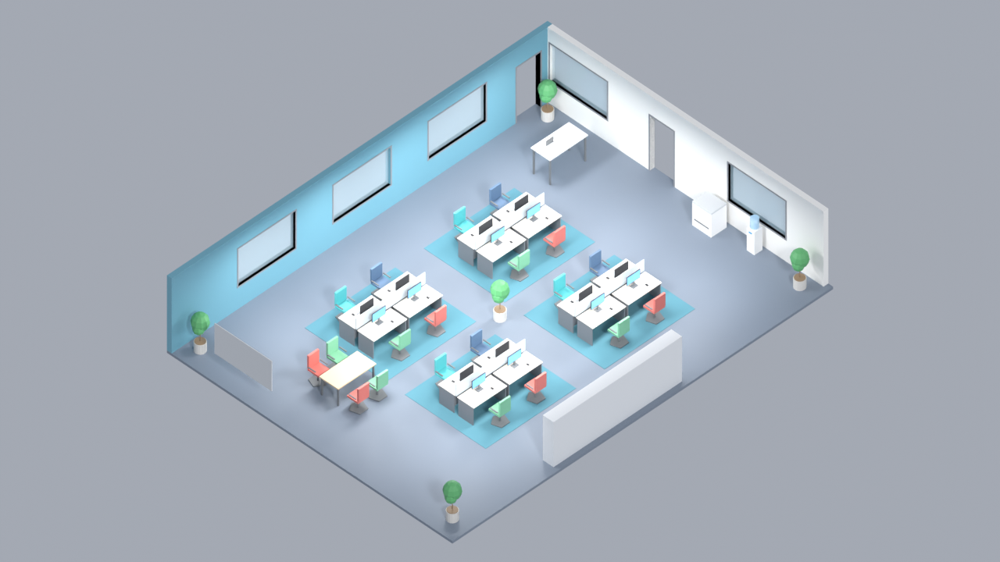 |
| 002 | [中型會議室](scenes/002_meeting_room/) | 8×6 m | 2 | 18（12 座位＋白板／簡報／飲水點） | 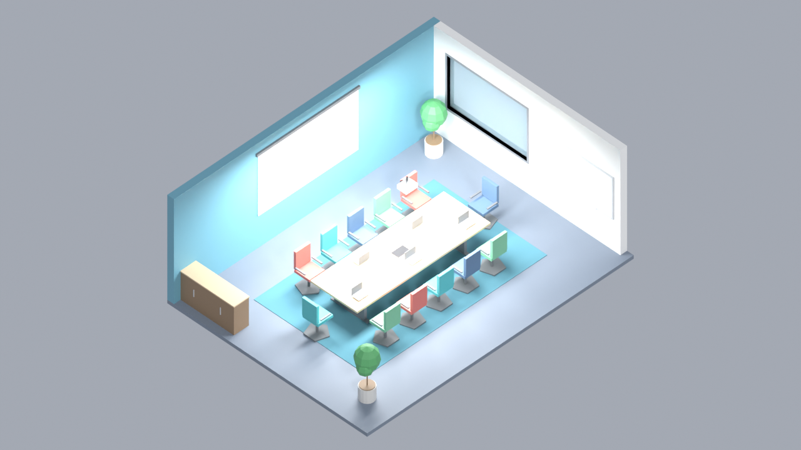 |
| 003 | [小型討論室／電話亭](scenes/003_huddle_room/) | 4×4 m | 2 | 9（4 討論座＋電話亭 1 座＋白板／螢幕） | 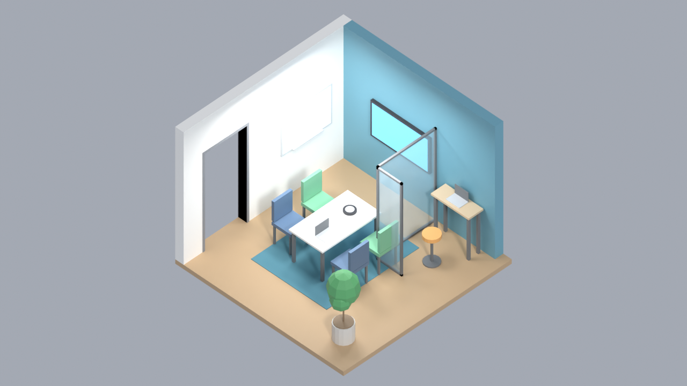 |
| 004 | [茶水間／咖啡吧](scenes/004_pantry/) | 8×6 m | 3 | 18（6 吧凳＋4 小圓桌座＋流理台／咖啡機／冰箱／販賣機互動點） | 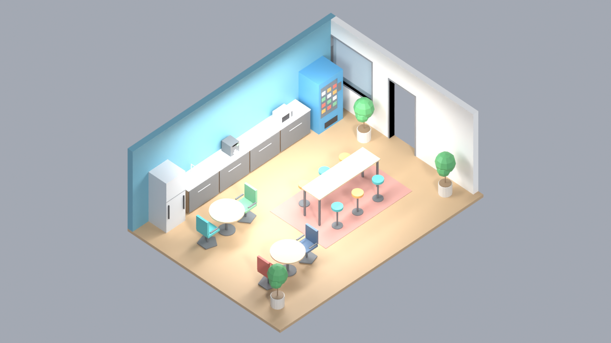 |
| 005 | [休憩交誼區](scenes/005_lounge/) | 10×8 m | 3 | 21（5 沙發座＋4 懶骨頭＋撞球／桌上足球站位＋電視） | 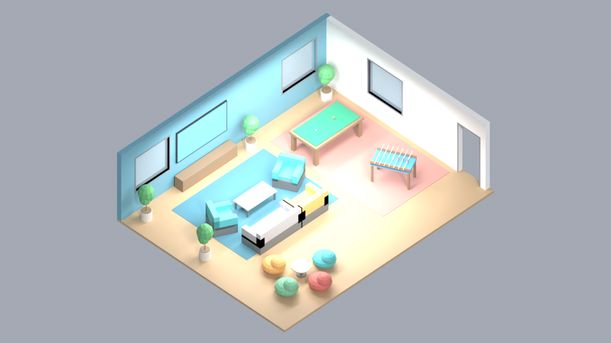 |
| 006 | [大廳接待區](scenes/006_lobby/) | 12×8 m | 6 | 20（2 接待座＋5 等候座＋閘機／登記機互動點） | 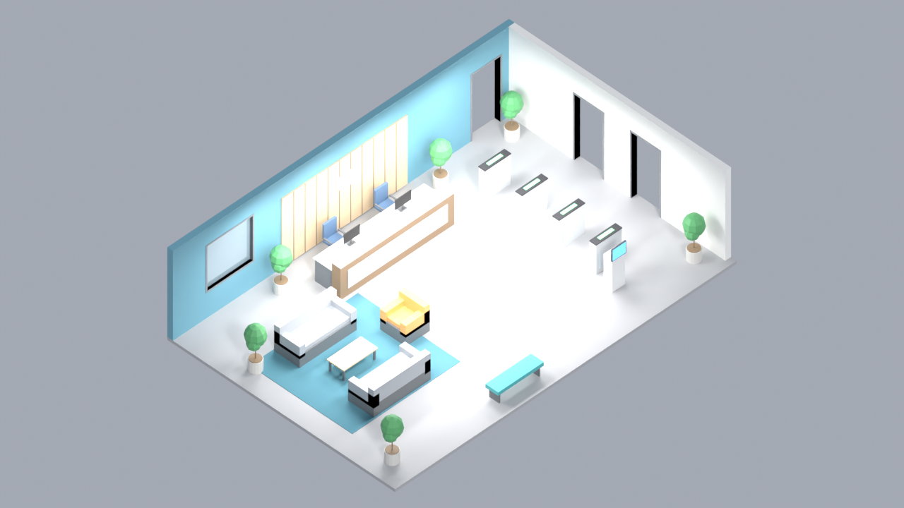 |
| 007 | [走廊（直線）](scenes/007_corridor_straight/) | 8×2 m | 6 | 6（4 路徑點＋2 狀態點） | 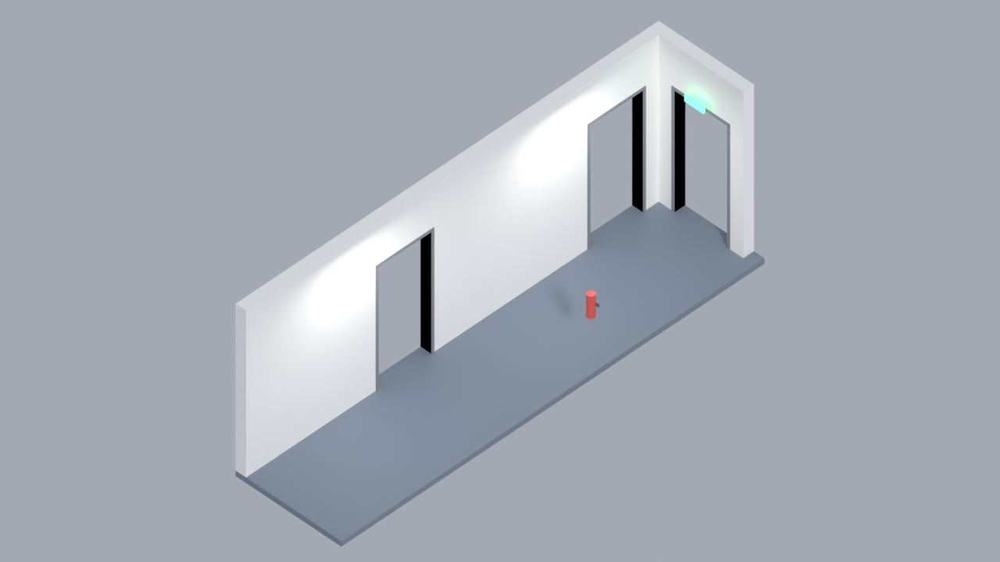 |
| 008 | [走廊（L 型轉角）](scenes/008_corridor_L/) | 2×2 m | 2 | 2 | 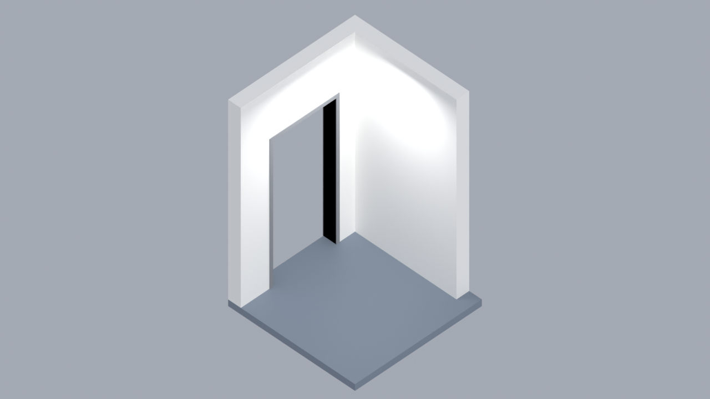 |
| 009 | [走廊（T 型岔路）](scenes/009_corridor_T/) | 2×2 m | 3 | 2 | 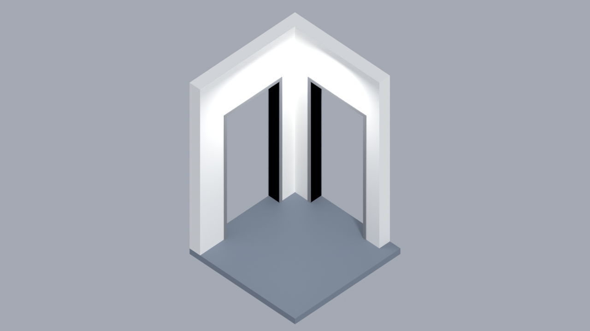 |
| 010 | [走廊（十字路口）](scenes/010_corridor_cross/) | 2×2 m | 4 | 2 |  |
| 011 | [主管辦公室](scenes/011_executive_office/) | 6×6 m | 2 | 11（主管座＋2 訪客座＋2 沙發座＋單人椅＋白板／櫃／書櫃互動點） | 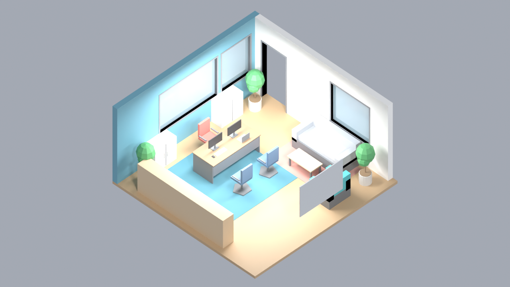 |
| 012 | [伺服器機房](scenes/012_server_room/) | 8×6 m | 2 | 22（12 機櫃巡檢站、維運座、冷卻／UPS／推車／備品互動點） | 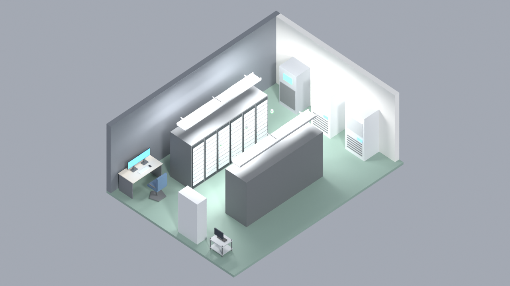 |
| 013 | [AI 代理人公司：任務控制中心](scenes/013_mission_control/) | 12×8 m | 2 | 26（9 監控席＋2 指揮席＋10 狀態燈＋螢幕牆／白板站位＋事務機／飲水互動點） | 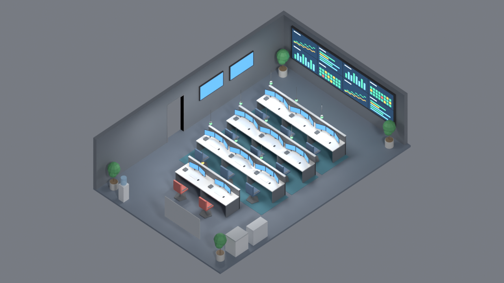 |
| 014 | [AI 代理人公司：代理人工作艙](scenes/014_agent_pods/) | 14×6 m | 4 | 23（8 工作艙座位＋8 狀態燈座＋總覽看板／交接桌站位＋補給櫃／事務機／飲水互動點） | 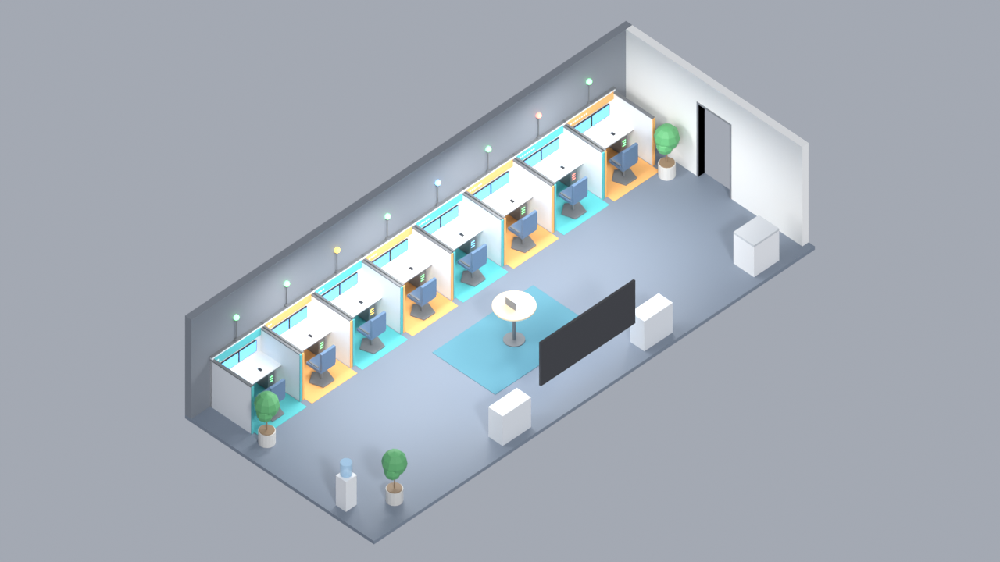 |
| 015 | [多功能活動空間](scenes/015_event_space/) | 16×12 m | 6 | 62（24 階梯座位＋12 活動椅＋4 懶骨頭＋4 工作坊座＋影音控制席；舞台／講桌／白板／站立圓桌站位；茶點／咖啡互動點；6 狀態點） | 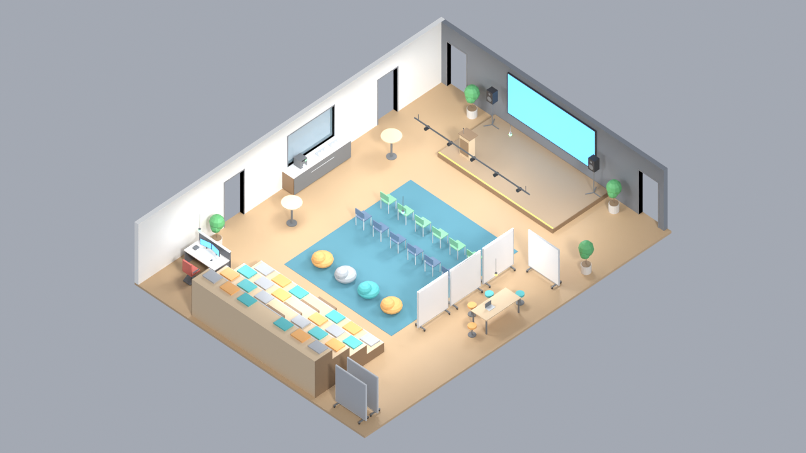 |

## 組合範例：AI 代理人公司一層樓
`compose/ai_company_layout.json` → `python3 tools/compose.py compose/ai_company_layout.json` 產生 `compose/ai_company_floor.{blend,glb,json}`
（14 個模組、16 組連通門、無重疊；隨新場景持續擴充；另輸出頂視圖 `ai_company_floor_top.png`）。

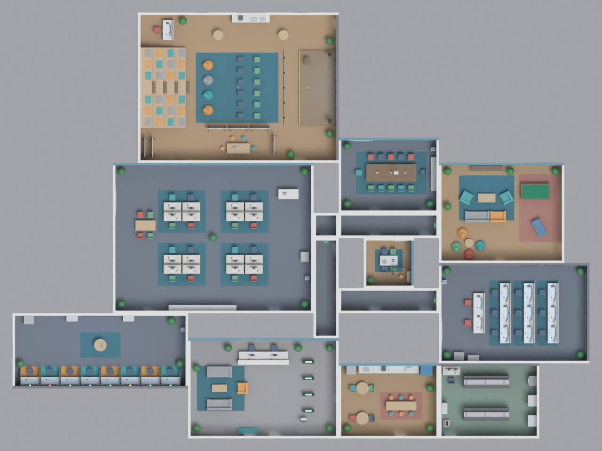

## 目錄
```
scenes/<NNN>_<slug>/   scene.blend / scene.glb / navmesh.glb / scene.json / preview.png / plan.png / build.py
tools/scenelib.py      共用：牆、地板、門窗洞、燈、錨點、導航網格、輸出與渲染
tools/furniture.py     共用：桌椅、螢幕、櫃、白板、沙發、影印機、機櫃、監控工位、拼接螢幕牆、代理人工作艙、階梯座位、可移動隔間、舞台等參數化家具
tools/verify.py        驗證某場景輸出（glb 重讀、錨點數、門洞、導航、高架錨點）
tools/corridor.py      走廊／樞紐模組產生器（寬 2 m）
tools/compose.py       依 compose/layout.json 組合多場景成一層樓
tools/mock_agent_server.py  模擬 AI 代理人後端（WebSocket，示範執行期協議）
compose/               layout.json 範例、ai_company_layout.json（AI 公司一層樓）與組合輸出
                       注意：layout 檔名不可與其 name 同名（輸出 <name>.json 會覆寫輸入）
viewer/index.html      Three.js 瀏覽器（可用 GitHub Pages）
viewer/engine.js       世界引擎：導航、人物狀態、指令、鏡頭跟隨、人物面板
```

## 使用
```bash
pip install bpy            # Blender Python 模組（Python 3.11/3.13 皆可）
python3 scenes/001_open_office/build.py          # 重建單一場景
python3 tools/verify.py scenes/001_open_office   # 驗證
python3 tools/compose.py compose/layout.json     # 組合一層樓
```
Viewer：在 repo 根目錄 `python3 -m http.server`，開 `http://localhost:8000/viewer/`；或啟用 GitHub Pages 後開 `/viewer/`。
支援切換錨點／導航網格／天花板，以及「Demo 人物」（人物依導航網格在錨點間走動，STATUS 位置顯示工作中／開會中／閒置）。

### 人物互動（viewer/engine.js）
- **點人物**：鏡頭平滑跟隨，右側面板顯示狀態、任務、精力、自訂變數與行為紀錄；**雙擊**切肩後視角，**Esc** 返回全景。
- **下指令**：面板輸入自然語言（例：「去泡咖啡，然後回座位」）或按快捷鍵。未連後端時由內建解析器模擬 AI；連上後端時指令會送給 AI 決定動作。
- **接外部程式**：`world.apply({type:'agent.state', id:'coder-1', state:'work', task:'實作 API', anchor:'SEAT_desk_03'})`，或網址加 `?ws=ws://localhost:8765` 連 WebSocket。協議見 [SPEC.md 執行期協議](SPEC.md#執行期協議草案-v01)。
- **範例後端**：`pip install websockets && python3 tools/mock_agent_server.py`，會產生 3 位 AI 代理人、定期派工並回應指令；把其中的 `decide()` 換成 LLM 呼叫即可接真 AI。

## 組合（compose）
`compose/layout.json`：`tiles[]` 列出 `scene`（資料夾名）、`offset`（旋轉後外框西南角，2 m 倍數）、`rot`（0/90/180/270，繞場景西南角）。
輸出 `<name>.blend/.glb/.json/_navmesh.glb`，json 內含合併後的門與錨點（id 加 `T<序號>_` 前綴）與重疊警告。

## 程式整合提示
- `scene.json` 的座標為 Blender Z-up；glb 為 glTF Y-up（`gx=x, gy=z, gz=−y`）。
- 人物面向：anchor `yaw_deg=0` 面向 +Y（北）。Three.js 中朝向 = `(−sinθ, 0, −cosθ)`。
